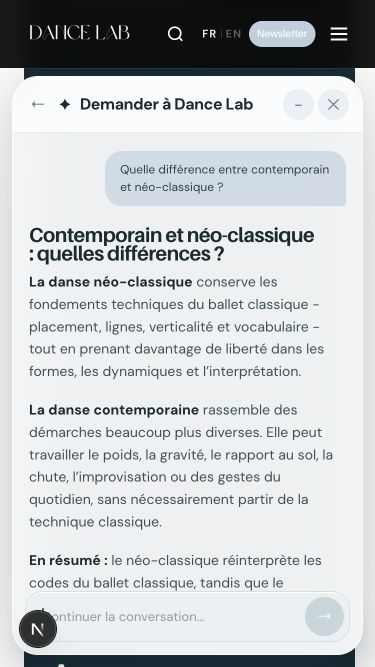
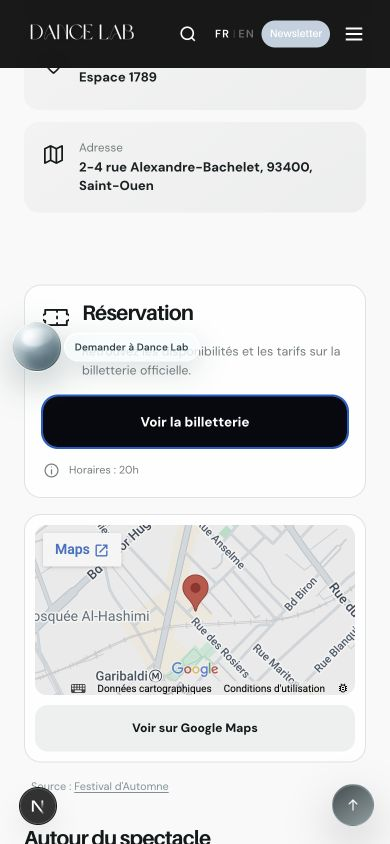
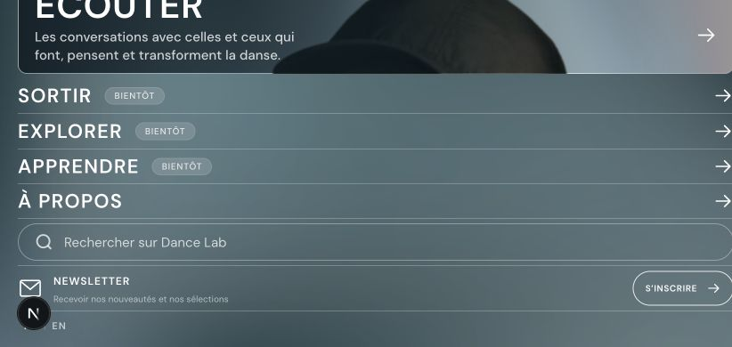

# Audit responsive Dance Lab - 15 octobre 2026

## Périmètre et méthode

Audit dans un navigateur Chromium réel, avec modification du viewport, captures,
défilement, clics, saisies, ouverture des menus et déplacement de la sphère.
22 pages représentatives des modèles publics et des rubriques en préparation ont
été contrôlées. Il ne s'agit pas d'une visite individuelle de chacune des centaines
de fiches utilisant ces modèles.

Formats : 375 × 667, 390 × 844, 430 × 932, 480 × 900, 768 × 1024,
1024 × 768 et 844 × 390 pixels. Les deux derniers couvrent le paysage.
Cela représente 154 contrôles page/format. La matrice finale est dans
[matrice.json](./matrice.json). Cinq pages principales ont aussi été revues à 1440 × 900.

## Problèmes détectés et corrections

| Emplacement | Constat | Correction |
| --- | --- | --- |
| Header partagé | À 375 px, le menu dépassait à droite : son bord atteignait 381 px. | Largeur du logo adaptée à l'espace mobile, sans changement du header desktop. |
| Menu mobile | En paysage 844 × 390, un contenu de 594 px était enfermé dans 390 px avec `overflow: hidden`. Les derniers liens étaient inaccessibles. | Défilement vertical du menu, conservation de la hauteur des éléments et confinement du défilement au menu. |
| Footer partagé | À 844 px, les trois colonnes forçaient une largeur de page de 918 px. | Deux colonnes entre 769 et 1000 px ; composition mobile et grand desktop conservées. |
| Écouter | La hauteur maximale desktop du contenu du hero comprimait la zone de filtres à 0 px sur téléphone. | Retrait de cette limite sur mobile et protection de la hauteur de la ligne de filtres. Zone mesurée après correction : 37 px. |
| Sortir - filtres | Le menu Type atteignait environ 811 px dans un écran haut de 667 px. | Calcul de la place disponible, ouverture vers le haut si nécessaire et défilement interne. Menu vérifié après correction : bord inférieur à 655 px. |
| Fiches événements | Présence des deux flèches diagonales demandées. | Retrait des seuls caractères décoratifs des boutons Billetterie et Google Maps dans le template commun. Textes, liens, classes et dimensions conservés. |
| Fiches événements - chargement | La fiche attendait l'enrichissement des pages externes et le géocodage de l'ensemble du catalogue. | Mode API `view=detail` : conserve les métadonnées du catalogue et les recommandations, sans lancer ces traitements bloquants pour afficher une fiche. |
| API événements | Un champ absent pouvait faire échouer le nettoyage de texte et basculer toute la réponse sur le catalogue de secours. | Valeur vide par défaut pour le nettoyage des champs absents. |
| Écoles de danse | Des dizaines de cartes d'activités précédaient l'annuaire ; celui-ci commençait à plus de 21 000 px sur mobile. | Six activités au premier rendu, puis ajout de six par « Voir plus ». Aucun événement retiré du catalogue. |
| Chatbot | La hauteur mobile et sa position minimale pouvaient faire dépasser le panneau du bas de l'écran. | Hauteur maximale liée à l'espace disponible, marge horizontale de 12 px et recalage au redimensionnement. Prise en compte de `visualViewport` pour les variations de hauteur visible. |

## Résultats par page

Toutes les lignes ci-dessous ont été contrôlées aux sept formats. Aucun débordement
horizontal persistant ni image déjà chargée en erreur n'a été détecté dans la matrice
finale. Les bandes/carrousels prévus pour défiler restent volontairement scrollables.

| Page | Résultat |
| --- | --- |
| `/` | Hero, cartes, images et footer contenus dans la largeur. Corrections partagées du header/footer appliquées. |
| `/ecouter` | Filtres rétablis ; cartes horizontales, titres et pagination vérifiés. Menu Durée ouvert et utilisable. |
| `/ecouter/derniers-episodes` | Affichage ou redirection vers la liste des épisodes contrôlé. |
| `/episodes/132-shaun-bui` | Hero, corps, médias conditionnés au consentement et sidebar responsive contrôlés. |
| `/decouvrir` | Hero, articles et compositions éditoriales contrôlés ; lecture des cartes vérifiée après leur apparition au scroll. |
| `/decouvrir/articles-culture` | Liste d'articles contenue dans la largeur. |
| `/decouvrir/articles/5-lieux-freestyler-paris` | Hero et contenu long sans débordement observé. |
| `/sortir` | Filtres ouverts, sélection Battle appliquée et résultats actualisés. |
| `/sortir/portrait-de-rita` | Informations pratiques, réservation, carte et recommandations contrôlées ; deux boutons sans flèche aux sept formats. |
| `/explorer/metiers-de-la-danse` | Header, filtres horizontaux et cartes contrôlés après défilement. |
| `/explorer/metiers-de-la-danse/interpreter` | Modèle de catégorie contenu dans la largeur. |
| `/explorer/metiers-de-la-danse/creer/choregraphe` | Hero, navigation de catégorie et sections de la fiche contrôlés. |
| `/explorer/ecoles-de-danse` | Activités limitées au premier groupe ; « Voir plus » testé : 6 puis 12 cartes. Annuaire permanent conservé. |
| `/explorer/ecoles-de-danse/centre-danse-marais` | Modèle de fiche établissement contrôlé. |
| `/explorer/styles-de-danse` | Grille et blocs éditoriaux contenus dans la largeur. |
| `/explorer/styles-de-danse/contemporain` | Hero, navigation et contenu éditorial contrôlés. |
| `/explorer/auditions` | Mise en page et contrôles contenus dans la largeur. |
| `/apprendre` | Modèle de rubrique en préparation contrôlé localement. |
| `/a-propos` | Mise en page et images contrôlées. |
| `/themes/corps` | Modèle de page thématique contrôlé. |
| `/mentions-legales` | Contenu long et liens contenus dans la largeur. |
| `/politique-de-confidentialite` | Contenu long et liens contenus dans la largeur. |

## Interactions vérifiées

- Ouverture du menu mobile, dépliage d'Explorer et accès aux six sous-rubriques.
- Défilement effectif du menu en paysage : position de scroll atteignant 204 px.
- Recherche globale avec « danse » ; « Voir tous les résultats » affiche 154 résultats
  dans la même interface, sans navigation vers une page annexe.
- Filtre Durée d'Écouter ouvert et lisible ; filtres Sortir ouverts et sélection Battle appliquée.
- Déplacement de la sphère de droite vers gauche : la sphère reste dans l'écran,
  le libellé passe à droite et reste entièrement visible.
- Chatbot ouvert aux sept formats, avec contrôle du panneau et de la barre de saisie.
  À 375 × 667 : panneau de x=12 à x=363 et de y=76 à y=655.
- Réponse développée sur contemporain/néo-classique et recommandations lisibles.
- Clic d'une recommandation Break : réduction du panneau, navigation Next.js vers
  la fiche, puis réouverture avec la conversation conservée.
- Les actions principales des cartes sont disponibles au clic ; aucune action
  principale testée ne nécessite de survol.

## Vérifications techniques et performances

- TypeScript : valide.
- Audit source : valide.
- Tests existants : 62 réussis. Le contrôle des dates inclut maintenant le cas des
  événements explicitement récurrents, déjà admis dans le catalogue.
- Build de production : réussi.
- Contrôle desktop à 1440 px : pas de débordement persistant sur les cinq grandes pages.
- La fiche événement prenait environ 22 secondes sur un premier chargement de
  développement avant correction. Un contrôle ultérieur mesurait environ 3,9 secondes,
  compilation et dépendances du layout comprises. Ces mesures locales ne constituent
  pas un benchmark de production à conditions identiques.
- Contrôle HTTP de production locale : Écouter répondait en environ 1,09 seconde.
  Sortir renvoie volontairement vers son accès privé en production : ce renvoi ne
  mesure pas le temps de rendu de la fiche.

## Points restant à valider

- Safari/iOS et Android sur appareils physiques, notamment clavier virtuel,
  barres du navigateur, toucher et fluidité sur un téléphone peu puissant.
  Les tests effectués sont des simulations de dimensions dans Chromium.
- LCP/CLS et réseau mobile sur le déploiement Vercel : aucune mesure de terrain
  ni publication n'a été effectuée pendant cet audit.
- Le build signale encore que le flux RSS Ausha dépasse la limite de 2 Mo du cache
  Next.js. L'optimisation durable de ce cache reste à traiter séparément.
- Les intégrations externes dépendent du consentement et de la disponibilité de
  leurs fournisseurs. Les liens de réservation et Google Maps restent présents.
- L'audit par modèles ne garantit pas chaque titre, chaque image et chaque contenu
  particulier du catalogue. Les pages et formats réellement testés figurent dans la matrice.

## Captures

